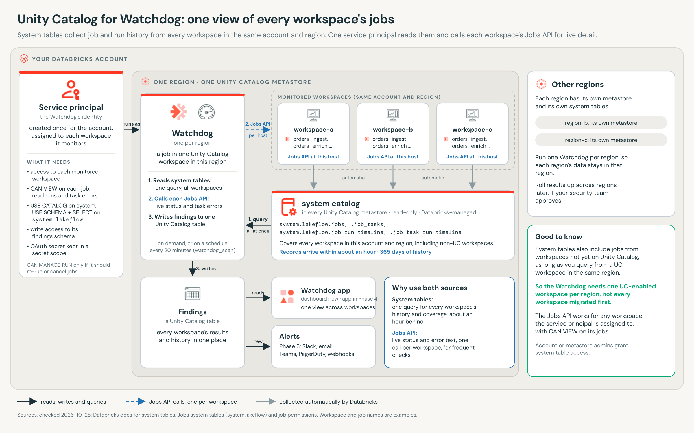
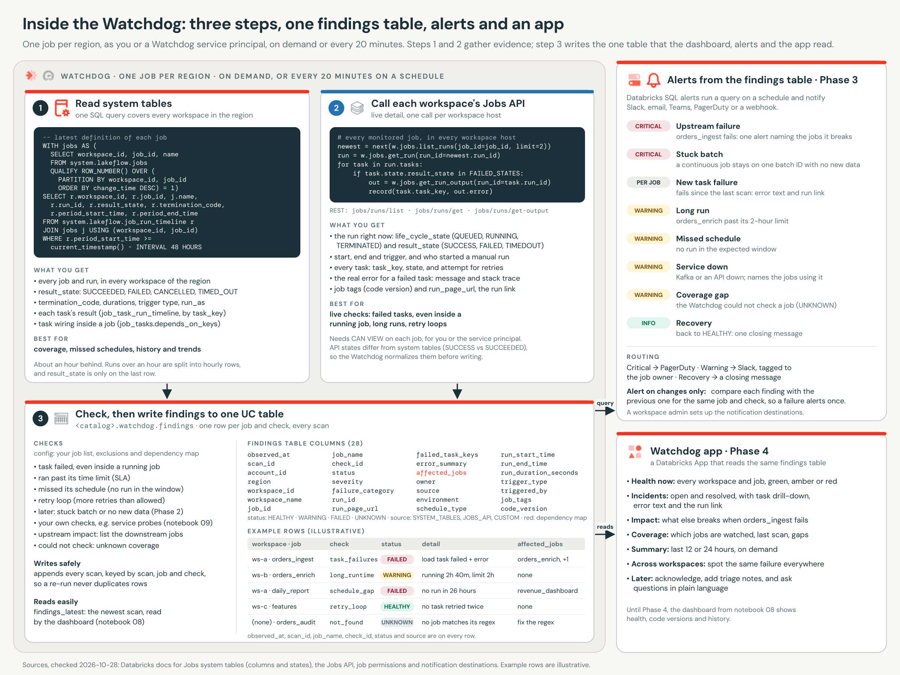

# Watchdog: job monitoring across Databricks workspaces

Watchdog checks your Databricks jobs in every workspace of a cloud region and writes what it finds into one Unity Catalog table. It is built in phases. **Phase 1**, in this repo today, creates the tables, loads your list of jobs to watch, and runs the first scans, by hand or as an on-demand job.

## Why

A platform team often runs hundreds of jobs spread over many workspaces. When an upstream job fails, the jobs that depend on it fail or go stale too, and often nobody notices until a report is wrong. The Jobs page in each workspace shows that workspace only, so answering "is everything healthy right now?" means opening each one.

Watchdog answers that question in one place. It reads two sources:

- **System tables**: read-only tables that Databricks keeps for you in the `system` catalog. One query covers the job and run history of every workspace in the same account and region. They run about an hour behind.
- **The Jobs API**: the REST API of each workspace. It is live and returns the real error text of a failed task, but each call answers for one workspace.

Every check writes a row to one table, `findings`. A row says which job, which check, its status (HEALTHY, WARNING, FAILED or UNKNOWN), what was found, and which downstream jobs a failure affects. Later phases add a schedule, alerts and an app, all reading that same table.

## Architecture



Each region has one Unity Catalog metastore, and its system tables collect job history from every workspace in that account and region. The Watchdog runs as a job in one Unity Catalog workspace in the region. It queries the system tables once, calls each workspace's Jobs API for live detail, and writes findings to one table. Run one Watchdog per region.



Inside a scan, step 1 reads the system tables, step 2 calls the Jobs API, and step 3 checks both against your config and writes findings. Alerts (Phase 3) and the app (Phase 4) read the same table. [docs/architecture.md](docs/architecture.md) walks through both diagrams.

### What Phase 1 checks

| Source | `check_id` | Finds |
|---|---|---|
| System tables | `last_run_result` | scheduled jobs: the newest finished run in the lookback window; continuous jobs: the newest run, even while it runs |
| | `task_failures` | tasks whose newest attempt failed, in the job's newest run |
| | `schedule_gap` | a scheduled job with no run started within `max_gap_minutes` (plus 60 minutes for system table lag) |
| | `long_runtime` | the newest finished run, or a run still going, over `max_runtime_minutes`, measured up to its newest system table record |
| | `not_found` | a monitored job whose name pattern matches no job in the region |
| Jobs API | `live_run_status` | the state of the newest run, right now |
| | `live_task_failures` | failed tasks in the newest run, with their error text, even while the run continues |
| | `live_long_runtime` | a run still going past `max_runtime_minutes` |
| | `retry_loop` | a task retried more than `max_retries` times |
| | `not_found` | no job matches the name pattern in the workspaces checked |
| | `api_unreachable` | a workspace or job could not be read (a coverage gap) |

## What this deploys

In the catalog and schema you choose (schema `watchdog` by default):

- `monitored_jobs` and `job_dependencies`: your config, loaded from a YAML file.
- `findings`: one row per job, check and source in each scan. Re-running a scan never adds duplicate rows.

Notebook `01_create_tables` creates these tables. The bundle does not own them, so they and your findings history survive a teardown unless you ask for the schema to be dropped.

With the bundle (`databricks.yml`):

- `watchdog_phase_1`: an on-demand job (no schedule) that runs the eight notebooks as serverless tasks.
- With `-t demo`, two sample jobs as well: `watchdog_demo_succeeds` and `watchdog_demo_fails` (its `load` task fails on purpose), so a new workspace has something to watch.

Phase 1 creates no clusters, SQL warehouses, apps, alerts or secrets.

## Prerequisites and features to enable

- **A Unity Catalog workspace** in the region you want to watch, with **serverless compute** for notebooks and jobs.
- **System tables**: the `system.lakeflow` schema (jobs, runs and task runs). `system.access.workspaces_latest` (Public Preview) adds workspace names and run links; it is optional in `current_workspace` mode and required in `service_principal` mode. An account admin enables system schemas if they are not on yet.
- **Grants for the identity that runs the notebooks or the job** (a metastore admin grants these):
  - `USE CATALOG` on `system`, plus `USE SCHEMA` and `SELECT` on `system.lakeflow` and `system.access`;
  - `USE CATALOG` and `CREATE SCHEMA` on the catalog that holds the Watchdog schema.
- **Job permissions**: `CAN VIEW` on each job you monitor, to read its runs and error output. Phase 1 never needs `CAN MANAGE RUN`.
- **Every-workspace mode only** (`auth_mode: service_principal`): a service principal with an OAuth secret, added to each workspace it monitors, with `CAN VIEW` on the monitored jobs. Store its application ID and secret in a secret scope that only you and the job's identity can read. If your workspaces use IP access lists or private networking, the job must be able to reach each workspace's address.

[docs/phase-1-runbook.md](docs/phase-1-runbook.md) lists every step by role, with the exact grants.

## Run Phase 1

Both paths use the same notebooks. Settings come from `accelerator.yaml`: copy it to `accelerator.local.yaml` (git-ignored) and fill in `target.catalog` and `target.region`. Copy `config/monitored_jobs.example.yml` somewhere outside the repo, list your own jobs, and point `scan.monitored_jobs_path` at it. The example file works as is with the demo jobs.

### By hand, in a Git folder

1. Clone this repo into a Databricks Git folder ([docs/git-folder-setup.md](docs/git-folder-setup.md)).
2. Open `notebooks/` and run, in order, on serverless compute:

| Notebook | Does |
|---|---|
| `00_check_access` | confirms system table and Jobs API access; changes nothing |
| `01_create_tables` | creates the schema and the three tables |
| `02_load_config` | loads your monitored-jobs file and shows which real jobs each entry matches |
| `03_explore_system_tables` | runs each read-only query in `sql/explore`, with notes |
| `04_explore_jobs_api` | walks one job through the three Jobs API calls |
| `05_scan_system_tables` | writes the system table findings |
| `06_scan_jobs_api` | writes the Jobs API findings |
| `07_validate_phase_1` | prints PASS or FAIL for each Phase 1 check |

Each notebook takes its inputs from widgets at the top, with defaults from `accelerator.local.yaml` (or `accelerator.yaml`). Give notebooks 05 and 06 the same `scan_id` to make one scan across both sources, or leave it empty in both: notebook 07 then checks each source's newest scan.

### As a job, with the bundle

From a laptop with the [Databricks CLI](https://docs.databricks.com/dev-tools/cli/) and Python 3.10 or later with PyYAML (`pip install pyyaml`):

```bash
cp accelerator.yaml accelerator.local.yaml        # then fill in catalog and region
eval "$(python3 scripts/bundle_vars.py --export accelerator.local.yaml)"
databricks bundle validate -t dev --profile <your-profile>
databricks bundle deploy -t dev --profile <your-profile>
databricks bundle run watchdog_phase_1 -t dev --profile <your-profile>
```

`scripts/bundle_vars.py` turns `accelerator.local.yaml` into `BUNDLE_VAR_*` environment variables, which the CLI reads as bundle variables. The job passes its run ID as `scan_id`, so both scans in one run share one scan.

To see results in a workspace with no jobs of its own yet, deploy the `demo` target, run the two sample jobs once (the failing one makes `bundle run` report an error, as intended), then run the Watchdog:

```bash
databricks bundle deploy -t demo --profile <your-profile>
databricks bundle run watchdog_demo_succeeds -t demo --profile <your-profile>
databricks bundle run watchdog_demo_fails -t demo --profile <your-profile>
databricks bundle run watchdog_phase_1 -t demo --profile <your-profile>
```

Both targets use development mode, so deployed names start with `[dev <your name>]` and nothing is scheduled. The example config's patterns match the sample jobs with that prefix.

### Remove it

```bash
./teardown.sh -t dev --profile <your-profile>                 # the job and the bundle's files
./teardown.sh -t demo --drop-schema --profile <your-profile>  # also the sample jobs and the Watchdog schema
```

`--drop-schema` asks you to type the schema name first. A service principal, secret scope or grants you created for the Watchdog are yours to remove.

## Deploy with Genie Code

[DEPLOY.md](DEPLOY.md) is a step-by-step playbook for Genie Code, the Databricks coding agent, to run inside your workspace. It asks you for each value, checks permissions and features, writes `accelerator.local.yaml`, and **stops for your review** before it creates anything.

## Phases

| Phase | What it adds | Status |
|---|---|---|
| 1 | Tables, config, both scans into one `findings` table, validation | Built: this repo |
| 2 | A schedule (every 20 minutes), an incident view that changes only when a status changes, more checks such as stuck batches and service probes | Planned |
| 3 | Databricks SQL alerts on `findings`, sent to Slack, email, Microsoft Teams, PagerDuty or a webhook, with severity routing and recovery messages | Planned |
| 4 | The Watchdog app, a Databricks App reading `findings`: health, incidents, impact, coverage | Planned |
| 5 | Other regions and production, and a cross-region roll-up if your security team approves | Planned |

[docs/roadmap.md](docs/roadmap.md) has the detail.

## Security notes

- `findings` can hold error text from your jobs. Govern it with Unity Catalog grants like any operational table.
- Catalog and schema names must be letters, digits or underscores, and are checked before any SQL runs. Values reach SQL only as named parameters, and table names only through `IDENTIFIER()`.
- The service principal's secret stays in a secret scope. Nothing in this repo stores a token, host or secret.

## Repo layout

```
accelerator.yaml       the settings you review; copy to accelerator.local.yaml
DEPLOY.md              Genie Code playbook
databricks.yml         bundle: dev and demo targets
resources/             the watchdog_phase_1 job
teardown.sh            bundle destroy, plus an optional schema drop
config/                example monitored-jobs file
notebooks/             00 to 07, plus _setup (shared widgets and paths)
sql/setup/             schema and table DDL
sql/config/            loads the config tables
sql/explore/           read-only system table queries
sql/scan/              system table checks and the findings merge
sql/validate/          checks used by notebook 07
jobs_watchdog/         Python package the notebooks use
demo/                  the two sample job notebooks
scripts/               bundle_vars.py
tests/                 pytest, no network: python -m pytest
docs/                  guides and diagrams
```

## Docs

- [Architecture](docs/architecture.md): both diagrams, explained.
- [Data model](docs/data-model.md): the three tables, column by column.
- [Queries](docs/queries.md): every SQL file, what it answers and how to read it.
- [Jobs API](docs/jobs-api.md): every Jobs API field the Watchdog reads.
- [Phase 1 runbook](docs/phase-1-runbook.md): step by step, by role.
- [Git folder setup](docs/git-folder-setup.md): cloning this repo into a workspace and pulling updates.
- [Roadmap](docs/roadmap.md): Phases 2 to 5.

## License

Apache License 2.0. Copyright 2026 Databricks, Inc. See [LICENSE](LICENSE).
